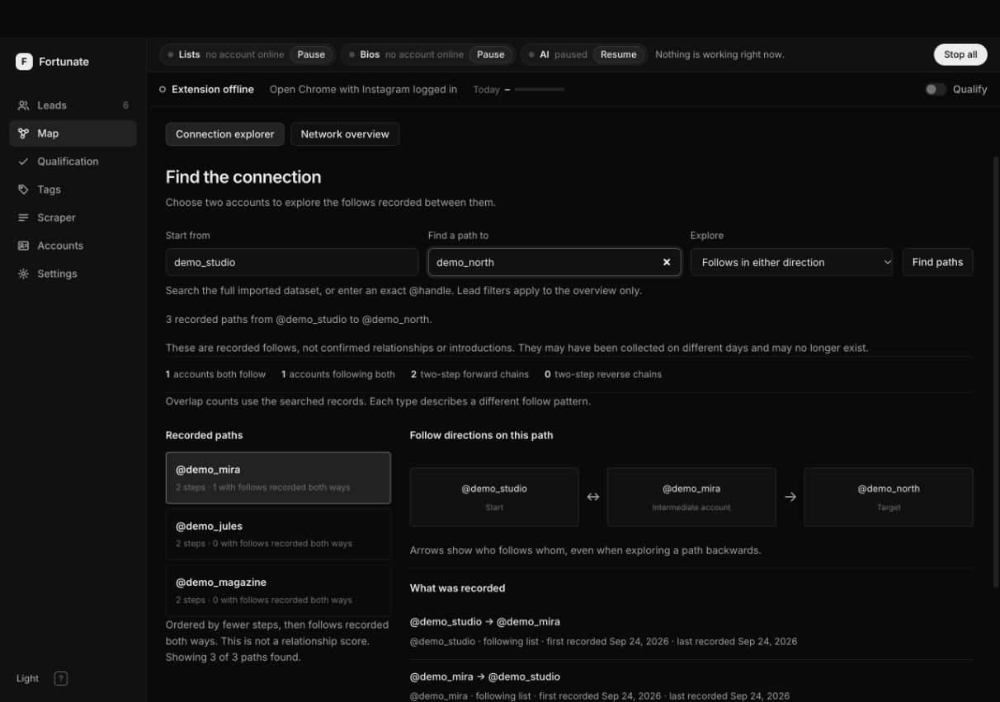
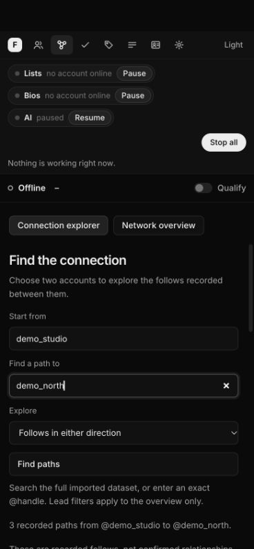

# Connection explorer validation

Verified on 26 September 2026 against base commit `9bac87489adad3637213c67780411f9b9127ec7c`. All data used for browser checks and benchmarks was synthetic. No live collection or production-database migration was run.

## Automated checks

| Check | Result |
|---|---|
| Full server suite: `python3 -m unittest discover -s server/tests` | 154 tests: 151 passed, 2 existing failures, 1 skipped; 57.13 seconds |
| New connection tests, included in that suite | All 22 passed: 16 graph/query, 3 storage, 3 HTTP/API |
| Extension: `node --test extension/test/*.test.mjs` | All 42 passed |
| `node --check web/app.js` and `node --check web/connections.js` | Passed |
| `git diff --check` | Passed |

The two server failures are `test_llm.LayaTest.test_batches_and_five_questions` and `test_server_pipeline.PipelineTest.test_laya_prequalifies_without_bio_and_is_soft`. Review reproduced them on the unchanged base. The existing Laya health cache initializes its timestamp to zero with a false result, and returns that cached result while the monotonic clock is below 60 seconds. In this test environment the clock starts near zero, so the first health request is suppressed. A check at 61 seconds succeeds. This PR does not change Laya; the full suite is **not green** in this environment.

The new tests cover directed follower/following conversion, reciprocal observations, all four overlap patterns, short paths in both traversal modes, duplicate page delivery, observation dates, migration, merged local people, reused handles, unidentified historical members, later profile enrichment, input validation, unknown accounts, origin checks, and overview population disclosure. Direct observations are checked independently of neighborhood limits. A regression with 250 non-source neighbors verifies that batched middle-edge lookups find the reverse-supported three-step route without exhausting the query budget on empty lookups.

The committed graph test compares results to independent exhaustive simple-path enumeration on small graphs. A separate read-only review also checked 100 generated graphs against exhaustive paths and the four overlap definitions in both modes. These establish query correctness on the checked graphs, not the usefulness of a route for an introduction.

## Synthetic query benchmark

Reproduce with:

```sh
python3 tests/bench_connections.py --people 100000 --runs 5
```

The fixture contains 100,000 people and 132,755 captured observations with generated stable identities. It uses a temporary database, runs SQLite `ANALYZE`, and measures five executions per case. Results from this machine:

| Query | Median | Slowest of five |
|---|---:|---:|
| Starting-account suggestions | 3.49 ms | 4.13 ms |
| Handle-prefix search | 1.52 ms | 2.13 ms |
| Source to person | 39.12 ms | 57.76 ms |
| Person to person | 2.36 ms | 3.73 ms |

The source-to-person query found six paths, read 1,007 observations through 14 observation queries including six middle queries, and correctly returned `search_truncated: true` because an endpoint neighborhood was capped. It is not a claim that all possible routes were retrieved. The person-to-person case found no paths and was not truncated. Those different workloads should not be compared as equivalent searches. These timings cover local server queries only, not browser rendering, ingestion, or a production service-level guarantee.

## Browser checks

Checked the running application with six fictional accounts at desktop and 390-pixel mobile widths. The mobile document and body both measured 390 pixels wide: no horizontal page overflow. No browser console errors were reported during the final checks.

- Searching from `demo_studio` to `demo_north` returns three recorded paths in either-direction mode, including a shared-publication route.
- Forward-only mode returns the two forward chains and excludes the shared-publication route.
- A reciprocal hop displays a two-way arrow; traversing an incoming edge preserves its real follow direction.
- Selecting a route exposes its source list, direction, and recording dates. Missing and partial list coverage remains visible.
- An isolated target returns the qualified empty state, limited to the searched records and three steps.
- Selecting the historical `demo_old_source` record displays its missing-identity explanation and a direct observation. Its unverified historical handle has no live-profile link.
- Switching between explorer and overview works. Explorer mode hides overview-only filters. The `/` shortcut focuses the explorer's starting-account field.
- Submitting immediately after typing leaves suggestions closed; a queued suggestion request cannot reopen an obsolete menu.

Screenshots show fictional accounts and the final interface:





## Release limits

Startup adds an observation-summary table and indexes, preserving the existing membership table. Existing rows receive unknown historical endpoint IDs rather than today's identities; they can be inspected but cannot create unidentified intermediate bridges. The original research-database importer preserves IDs present in the source entities. Migration, repeated initialization, and observation merging have automated coverage, but have not been applied to the user's live database here.

The explorer presents historical recorded follows. It does not verify current follows, friendship, simultaneous existence of an entire path, or willingness to introduce. List coverage remains current handle-keyed metadata. Bounded searches can miss routes. Full collection-run provenance and measured introduction outcomes remain follow-up work described in the [research and design report](CONNECTION_MAPPING.md).
