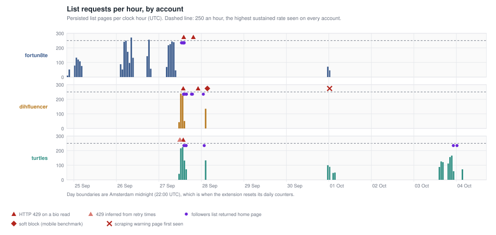
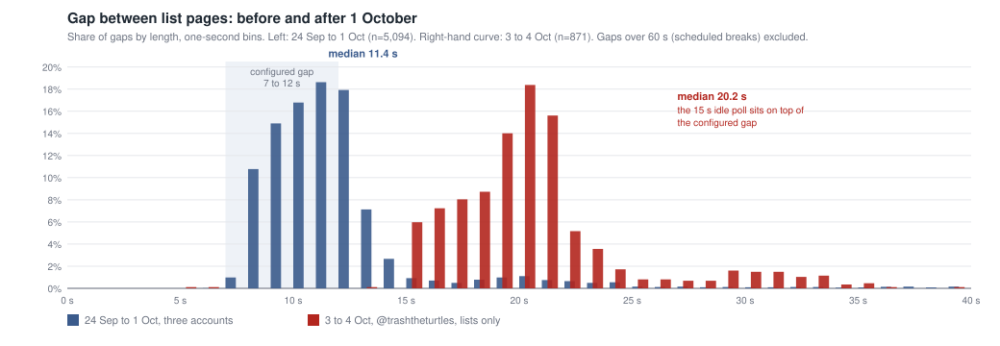
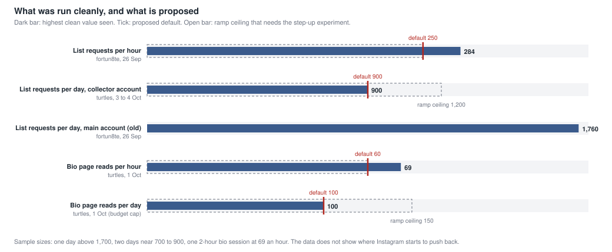
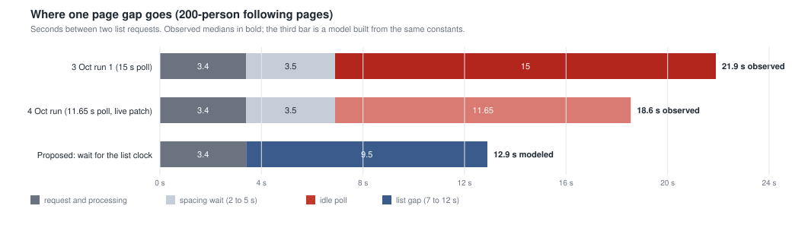
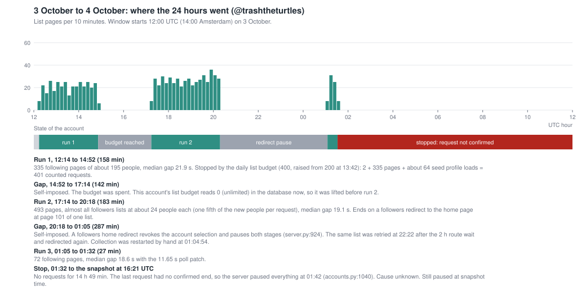

# Pacing evidence, 4 October 2026

How fast can Instagram collection go, and where is it slower than it needs to be? Everything below comes from the database snapshot of 4 Oct 16:21 UTC, the backups, the benchmark files and the code at `b3803de` (main). Line numbers cite that commit. The live checkout is older and carries one uncommitted change, described in section 7.

## TL;DR

- Safe daily list requests per account: **900** (about 760 pages, roughly 130,000 people when following lists are available). Bios: **100** a day. Confidence: medium for lists over a few days, low for bios. No sample found the real ceiling.
- Yesterday (3 to 4 Oct) the account made requests for 6.1 of 24 hours. 2.2 of those hours were waiting that served no pacing purpose. 17.6 hours were stops the app imposed on itself. Instagram sent no rate limit, warning or challenge in that window.
- Fastest supported speed: the configured 7 to 12 s gap, with the 15 s idle wait removed. That is about 13 s per page instead of 22 s, about 230 pages an hour instead of 130 to 160. The daily budget, not cadence, is what limits people per day.

## 1. What the evidence is, and what it is not

| Source | Covers | Limit |
|---|---|---|
| `pages` table | 6,195 dated list pages, 24 Sep 18:53 to 4 Oct 01:32 UTC, per account | Persisted pages only. Retries, seed profile loads and failed requests are missing. |
| `collector_events` | 2,690 events from 27 Sep 10:42 UTC: outcome, HTTP status, requested and returned counts | Starts three days after the pages. No latency, no successful non-page requests. |
| Extension `today` counters in the nightly backups | True request counts per Amsterdam day, a few snapshots | Only at backup times. |
| `data/benchmarks/*.sqlite`, `data/reports/*` | The 28 Sep mobile and Chrome benchmark, the 3 Oct live run files | Short. |
| `jobs.limit_hits` and `retry_not_before` | Lets me infer three 429 times the event table never recorded | Inference, marked as such. |
| `server.log` | Tracebacks without timestamps (86 `database is locked`) | Cannot be placed in time. |

What is missing: the extension keeps a per-request trail (status, milliseconds) in `chrome.storage` and nothing writes it to the database. Without it I cannot measure Instagram's response times, which is the best early warning there is. That is the single biggest reason the ceiling stays unknown.

Hard facts about the data:

- Zero HTTP 429 on any list endpoint in 6,195 persisted list pages and about 400 seed profile loads.
- Eight HTTP 429 in total, all on the old bio route (`/api/v1/users/{pk}/info/`). After bios moved to loading the profile page (first seen 27 Sep 23:05 UTC), 0 in 217 reads.
- One scraping warning (@dihfluencer), found on 30 Sep 22:24 UTC (section 4).
- The persisted pages understate real requests on some days. Example: @fortun8te on the Amsterdam day of 27 Sep counted 1,719 list requests in the extension but only 1,042 pages are saved. I could not recover the cause from the database.

Not in the data at all: the age of each account, Instagram's own limit values, and anything about time of day beyond the sessions that happened.

## 2. How collection is paced today

Per account, list pages: gap 7 to 12 s after each response, a break of 90 to 180 s every 40 to 60 pages, 2 to 5 s spacing after any request, and a sliding window of 72 requests per 11 minutes (`extension/lib/core.js:8-9`). Bio page loads: 35 to 70 s gap. Daily budgets: live 200 list and 100 bio, with @trashtheturtles at list 0 and bio 100. One request at a time across all accounts, 2 s apart (`server/accounts.py:1009`).

The full list of limits, with what each did in the data, is section 6.

## 3. Per account and per day



Amsterdam days (UTC+2), persisted pages. This is the day the extension resets its counters on.

| Day | Account | Pages | People | Bio loads | Other events | Active h | Busiest hour | Median gap |
|---|---|---:|---:|---:|---:|---:|---:|---:|
| 24 Sep | fortun8te | 62 | 2,944 | 0 | 0 | 0.6 | 52 | 11.4 s |
| 25 Sep | fortun8te | 516 | 24,326 | 0 | 0 | 4.3 | 133 | 10.8 s |
| 26 Sep | fortun8te | 1,760 | 48,581 | 0 | 0 | 7.1 | 271 | 10.8 s |
| 27 Sep | fortun8te | 1,042 | 48,751 | 0 | 19 | 5.5 | 244 | 11.7 s |
| 27 Sep | dihfluencer | 559 | 15,452 | 0 | 13 | 2.8 | 239 | 11.4 s |
| 27 Sep | turtles | 685 | 20,276 | 0 | 9 | 3.2 | 224 | 11.7 s |
| 28 Sep | dihfluencer | 135 | 6,729 | 39 | 1 | 0.6 | 135 | 11.1 s |
| 28 Sep | turtles | 133 | 6,157 | 44 | 1 | 0.6 | 133 | 10.5 s |
| 30 Sep | fortun8te | 71 | 1,594 | 1 | 0 | 0.6 | 71 | 21.0 s |
| 30 Sep | turtles | 100 | 9,906 | 36 | 1 | 0.6 | 100 | 10.7 s |
| 1 Oct | fortun8te | 46 | 1,105 | 0 | 0 | 0.4 | 46 | 21.0 s |
| 1 Oct | dihfluencer | 0 | 0 | 0 | 4 | 0.2 | 0 | |
| 1 Oct | turtles | 186 | 17,755 | 101 | 3 | 1.6 | 89 | 11.6 s |
| 3 Oct | turtles | 828 | 74,741 | 0 | 2 | 5.7 | 166 | 20.4 s |
| 4 Oct (to 03:32) | turtles | 72 | 13,234 | 0 | 1 | 0.5 | 72 | 18.6 s |

The same days in UTC, for cross-checking against the heartbeat files: 24 Sep 274 (fortun8te), 25 Sep 304, 26 Sep 1,760, 27 Sep 1,042 / 559 / 685, 28 Sep 135 / 133, 30 Sep 117 (fortun8te) / 189 (turtles), 1 Oct 97, 3 Oct 828, 4 Oct 72. Run `scripts/perday.py` for the full UTC table.

True request counts from the extension's own counters (nightly backups), which include seed profile loads and failed requests:

| Amsterdam day | fortun8te | dihfluencer | turtles |
|---|---:|---:|---:|
| 27 Sep | 1,719 list, 5 bio | 609 list, 5 bio | 729 list, 4 bio |
| 28 Sep (to 01:57 UTC) | n/a | 203 list, 38 bio | 143 list, 43 bio |
| 1 Oct | 47 list | 3 list, 2 bio | 200 list, 100 bio (budget reached) |
| 3 Oct | n/a | n/a | about 900 list (828 pages plus 64 seed loads in run 1 and more in run 2) |
| 4 Oct | n/a | n/a | 83 list |

### Gaps



Two regimes. From 24 Sep to 1 Oct the median gap between list pages was 10.5 to 13.1 s on every account, with 5th percentile 8.2 to 10.3 s and 95th percentile 12.5 to 24 s (up to 44 s where profile loads sat between pages). Only the main account's 30 Sep to 1 Oct runs sit at 21 s. On 3 and 4 Oct @trashtheturtles ran 18.6 to 21.9 s (5th percentile 15.5 to 19.9 s). The configured gap did not change between the two regimes. The reason is the idle wait, section 7.

Shortest gaps: 6.7 s on fortun8te (one gap under 7 s in 3,516), 0.7 to 3 s only between a bio load and a list page, as designed.

### Page sizes

| Account | Followers lists | Following lists |
|---|---|---|
| fortun8te | 25 per page (median 25) | 50 |
| dihfluencer | 25 (258 pages), 50 (21) | 50 (198), 100 (3) |
| turtles | 25 (947 pages), 50 (1) | 50 (304), **200 (566)** |

Observed yield per page, 3 Oct 12:14 to 4 Oct 01:32: following at 200 returned 176 people (168 saved, 438 pages); in run 1 that was about 96 first-time profiles per page. Followers at 25 returned 23.5 (about 20 first-time profiles, 462 pages). That is a factor of 4.8 in new people per request.

### Bursts and breaks

| Window | Most requests in one window, one account | Whole workspace |
|---|---:|---:|
| 1 minute | 7 to 8 | 15 |
| 5 minutes | 31 to 32 | 59 |
| 11 minutes (the sliding window) | 59 to 61 (cap 72, never reached) | 108 |
| 30 minutes | 144 to 149 | 277 |

Breaks ran as designed. Median break 91 to 182 s (range 63 to 573 s), median 11 to 51 pages between breaks. A break costs about 2.7 s per page on average, 11 to 19% of active time.

### Bios against lists

All 217 bio page loads (178 turtles, 39 dihfluencer) ran between 28 Sep 00:07 and 1 Oct 01:53 UTC, always interleaved with list pages: roughly one bio per three list pages. Median gap between bio loads 53 to 67 s, 55 to 69 an hour in four sessions of 30 to 65 minutes, never more than 100 to 101 in an Amsterdam day. 36 of the 178 turtles loads found a deleted or renamed profile (20%). 186 bios in the database came from the extension; the 14,000 earlier bios came from the archived logged-out collector and say nothing about account safety.

### Concurrency

Of 374 five-minute buckets with any request, 318 (85%) had one account active, 47 had two and 9 had three. Every multi-account bucket falls on 27 Sep (34), 28 Sep (8) and 30 Sep (14). The busiest hour for the whole workspace was 27 Sep 10:25 to 11:25 UTC: 511 pages from dihfluencer and turtles together. The shared request gate now makes this sequential, so this load cannot recur by accident.

### Time of day (Amsterdam)

fortun8te ran mostly 04:00 to 09:00 and 17:00 to 19:00; dihfluencer 11:00 to 14:00; turtles 11:00 to 16:00 and 19:00 to 23:00. No adverse event correlates with the hour. This is not evidence for or against a quiet-hours rule.

## 4. Every adverse event

Counted: any HTTP 429, "wait a few minutes", soft block, challenge, scraping warning, login prompt or request that never confirmed. Private-profile walls (14) and deleted profiles (36) are target conditions, not account events.

"Own pages" is persisted list pages by the same account in the 5 minutes, 1 hour and 24 hours before the event.

| # | When (UTC / Amsterdam) | Account | What | Own pages 5 min / 1 h / 24 h | Other accounts, previous hour |
|---|---|---|---|---|---|
| 1 | ~26 Sep 00:20 / 02:20 | fortun8te | 429, bio route, @markbuildsbrands. Time inferred from the stored cooldown (00:30:49 minus the 10 min base). | 1 / 2 / 267 | none running |
| 2 | 27 Sep 09:44:11 / 11:44 | turtles | 429, bio route (inferred from job 11177 retry time) | 1 / 1 / 1 | dihf: 1 |
| 3 | 27 Sep 10:02:08 / 12:02 | turtles | 429, bio route (inferred from job 11184) | 21 / 49 / 49 | dihf: 52 |
| 4 | 27 Sep 11:45:24 / 13:45 | dihfluencer | 429, bio route (job 12833, @markbuildsbrands) | 1 / 222 / 449 | turtles: 215 |
| 5 | 27 Sep 11:45:32 / 13:45 | turtles | 429, bio route (@cameron.fous, second hit) | 1 / 216 / 417 | dihf: 223 |
| 6 | 27 Sep 12:02:12 / 14:02 | fortun8te | 429, bio route (@niksetting) | 0 / 8 / 1,506 | dihf 220, turtles 229 |
| 7 | 27 Sep 17:28:07 / 19:28 | fortun8te | 429, bio route (@markbuildsbrands, 3rd hit) | 0 / 0 / 1,059 | none |
| 8 | 27 Sep 20:08:19 / 22:08 | dihfluencer | 429, bio route (@markbuildsbrands, 4th hit) | 0 / 0 / 570 | none |
| 9 | 28 Sep 01:22:28 / 03:22 | dihfluencer | HTTP 400, benchmark asked for 300 per page (not a limit) | benchmark | none |
| 10 | 28 Sep 01:24:25 / 03:24 | dihfluencer | soft block: HTTP 200 with 0 rows, mobile REST followers, 50 per page, benchmark | benchmark | none |
| 11 | 30 Sep 22:24:32, 22:27:08, 22:31:37, 22:37:03 / 00:24 to 00:37 | dihfluencer | Four retries that landed on Instagram's scraping warning page; the extension filed them as "no profile data" | 0 / 0 / 0 | fortun8te 84 to 88, turtles 117 to 132 list plus 41 to 44 bios |
| 12 | 3 Oct 20:17:58 and 22:22:05 / 22:17 and 00:22 | turtles | Followers list returned the home page, same list, page 101. The second is the retry after the 2 h hold. | 18 / 185 / 828, then 0 / 0 / 828 | none |
| 13 | 4 Oct 01:42:45 / 03:42 | turtles | A request had no confirmed end; the server paused all collection | 0 / 72 / 900 | none |
| 14 | 27 Sep to 3 Oct, 36 events | all | Followers list returned the home page (`list_html_home_redirect`). Target-specific. | | |

What the 429s say:

- Prior load does not predict them. In the hour before the eight bio 429s the same account had saved 2, 1, 49, 222, 216, 8, 0 and 0 list pages. Four of eight came with at most 2 pages in the previous hour.
- They hit the bio route only. Lists kept running through the 11:45 pair: turtles paged on until 12:14 and again from 12:39 to 13:21, dihfluencer until 11:59 and again 12:30 to 12:58.
- Eight timed hits (a ninth, the first on @cameron.fous, has no time) fall on five targets. @markbuildsbrands alone took four, across two accounts. Together with the first-minute hit (#2) this looks like the route itself being closed to scripts, which matches `docs/RESEARCH.md` section 2. It is not evidence about list volume.

What the 36 followers redirects say: 11 of the 15 list-and-account pairs redirected before the list had returned any page (jobs 70 and 82 were tried 6 times each, about 15 minutes apart). Those lists paged normally later (40 and 7 more pages). Job 292 (@bramkoningsecom) redirected for dihfluencer after 121 pages and for turtles after 157 pages, then both continued paging (more than 400 pages after). That is a target or depth effect, not an account effect.

### Special case: the scraping warning on @dihfluencer

Timeline from the database, in UTC:

| When | What |
|---|---|
| 26 Sep 23:17 | dihfluencer and turtles both first seen by the workspace, 81 seconds apart |
| 27 Sep 09:43 to 12:58 | both run lists in parallel, about 240 pages an hour each, median gap 11.3 s. Bio route 429s begin. |
| 27 Sep 23:05 to 28 Sep 00:44 | dihf: 135 list pages and 37 bios in 37 minutes, plus the pinned page-size experiment (50, 100, 200 per page, job ids 14582 to 14584). turtles the same minus the experiment: 133 pages, 44 bios. |
| 28 Sep 00:49 to 01:24 | dihf only: raw-edge benchmark, 54 requests at 12 s spacing through three transports: Chrome REST, **mobile REST** and **private mobile GraphQL** (a Python client using the saved session, device fingerprint `40db883e...`). Then a Chrome request for 300 per page (HTTP 400) and a mobile followers request that returned HTTP 200 with zero rows, recorded as `soft_block`. |
| 28 Sep 01:24 to 30 Sep 22:24 | no request from dihf for 45 hours |
| 30 Sep 22:24 to 22:37 | first request after the pause. Four attempts, 4 to 6 minutes apart, each opened a profile page that Instagram redirected to `/accounts/scraping_warning/`. The extension (older build) read it as "no profile data". The last error string is stamped 00:37 Amsterdam. |
| 30 Sep 22:54:40 | warning marker first written |
| 1 Oct 13:07:19 | marker rewritten when extension 3.9.30 was reloaded and saw the same tab. |

The 1 Oct 13:07 record is not a new Instagram event. dihf's counters did not move (`today` list 3, bio 2 from 01:29 through 13:07 UTC), no event from the lane exists after 22:37 UTC on 30 Sep, and the marker `at` equals the heartbeat of the reload.

What was different from the clean periods:

| | dihfluencer | turtles (stayed clean) |
|---|---|---|
| Requests in the same 26 hours (extension counters) | 812 list, 43 bio | 872 list, 47 bio |
| Median gap, session length, IP, extension version, hours of day | same | same |
| Bio route 429s | 2 recorded | 3 (2 inferred) |
| Page-size experiment (100 and 200 per page, web route) | yes | no |
| Traffic from a non-browser client (mobile REST and GraphQL) on the same session | **54 requests** | none |
| Soft block | **1** | none |
| Result | warning page found 45 h later | no event in 7 days and about 3,300 requests since |

Plain reading: web volume, cadence, session shape and time of day were the same for both accounts, so they do not explain the warning. The one structured difference is the mobile-client benchmark, followed by the only soft block on record. That is a suspicion, not a finding: one account against one, and account age, history and the trigger moment are unknown. It is enough to say what to do: no non-browser transport on a collector account, and no retry against a warning page. Both are already stop rules or flags in code (`server/accounts.py:687`, `extension/lib/core.js:134`).

## 5. The clean-rate envelope



"Clean" means no 429, soft block, challenge, warning or unconfirmed request on the list endpoints in the window or the 24 hours after, and the account still collected afterwards. Sample sizes are persisted pages.

| Measure | Account | Highest clean value | Window | Confidence |
|---|---|---:|---|---|
| List pages in one clock hour | fortun8te | 271 (best rolling 60 min: 284) | 26 Sep 06:00 UTC | medium: 3 accounts, 4 days, same ceiling |
| | dihfluencer | 239 (263) | 27 Sep 10:00 | |
| | turtles | 224 (250) | 27 Sep 10:00 | |
| List pages in 3 hours | fortun8te | 716 | 26 Sep 01:43 | medium |
| | turtles / dihf | 591 / 544 | 27 Sep | |
| List pages in 6 hours | fortun8te | 1,216 | 26 Sep 01:43 | low: one window |
| List pages in 24 hours | fortun8te (main, older account) | 1,760 pages (26 Sep), then 1,719 counted requests (27 Sep) | 26 and 27 Sep | **low**: one account, five days, no later check |
| | turtles | 900 pages, 87,975 people (about 970 requests with seed loads) | 3 Oct 12:14 to 4 Oct 12:14 | medium: 27 Sep (685) and 3 Oct (828), no event since |
| | dihfluencer | 694 | 27 Sep | not clean (warning, cause unclear) |
| Whole workspace in one hour | 2 accounts in parallel | 511 pages | 27 Sep 10:25 | low: one hour |
| Bio page loads in one hour | turtles | 61 to 69 (four sessions) | 28 Sep to 1 Oct | medium |
| Bio page loads in one day | turtles | 100 (the budget cap) | 1 Oct | **low**: one day, stopped by the budget, not by Instagram |
| Bio loads, total | turtles + dihf | 217, zero 429 | 28 Sep to 1 Oct | low-medium |

What I will not claim: that 900 a day or 250 an hour is a threshold. No sample ever saw a list limit, so these are the highest values that went without incident, not the point where trouble starts. The rule of three applies: after n clean days at a given level, the 95% upper bound on the per-day chance of an event is about 3/n. Two clean days say almost nothing (the bound is above 100%); ten clean days still allow about 30% a day. The experiment in section 9 cannot prove a number safe, only widen the range seen without incident while watching early signs.

## 6. Every limit the app puts on itself

Defaults are at `b3803de`. "Data" says what each limit did between 24 Sep and 4 Oct. "Backed" says whether the number comes from evidence.

| # | Limit | Where | Default | What the data shows | Backed? |
|---|---|---|---|---|---|
| 1 | List gap after each response | `core.js:8`, applied `:353` | 7 to 12 s | Ran for 6,195 pages on 3 accounts over 8 days; shortest gap 6.7 s; median 10.5 to 13.1 s | **Yes for 7 to 12 s.** Nothing tests lower. |
| 2 | Spacing after any request | `core.js:9`, `:348` | 2 to 5 s | Shows only between a bio load and a list page (3 to 5 s). In list-only mode it is added to the idle wait (section 7). | Part of the clean pattern |
| 3 | Break | `core.js:8`, `:354-357` | 90 to 180 s every 40 to 60 pages | 12 to 40 breaks per session, median 91 to 182 s. Costs 2.7 s a page. | Present in every clean run, never tested without. Keep. |
| 4 | Bio gap | `core.js:9`, `:350` | 35 to 70 s | Median 53 to 67 s, 55 to 69 an hour, 217 reads, no 429 | Yes, small sample |
| 5 | Sliding window, lists and bios together | `core.js:9`, `windowOf :363-366`, `plan :409` | 72 requests per 11 min (about 393 an hour) | Highest seen 61 for one account, 108 for the workspace. **Never bound once.** | No. A guard that never fired. |
| 6 | Daily budget, code default | `core.js:33`, `accounts.py:27`, `db.py:200` | 3,000 list / 300 bio (max 3,000 / 5,000) | Not used live | n/a |
| 7 | Daily budget, live | settings `budget`; `accounts.budget` | 200 list / 100 bio. fortun8te 200/100. dihfluencer inherits 200/100. **turtles list 0, bio 100.** | List 200 used up on 1 Oct 01:12 UTC after 186 pages. 400 used up on 3 Oct 14:52. | **No.** Set from "the existing main-account allowance" (`HANDOFF.md`) on 27 Sep evening, after 1,719 requests in one day had run clean with no budget (0/0). |
| 8 | Budget 0 | `core.js:445`, `accounts.py:295`, `server.py:2896` | 0 means no daily limit | turtles ran 567 pages past 400 on 3 to 4 Oct with no stop. The only limits left are items 1 to 5. Design maximum with no budget: about 270 an hour times 24 h, **around 6,500 requests a day.** | **No.** A loophole, not a chosen number. |
| 9 | What counts toward the budget | `core.js:344-349`, `background.js:601,631` | Every request sent, including the profile load at the start of each list run and any privacy re-check | 400 bought 335 pages: 64 loads at 16%. Failed requests count. | Honest count, but the overhead is avoidable |
| 10 | Day boundary | extension `core.js:247,293` (Chrome local time); server enforcement `accounts.py:104,299` (server local time); UI counts and wait text `control.py:118,134` (**UTC**) | | Counters reset at 22:00 UTC (Amsterdam midnight). UI "today" resets at 00:00 UTC, so a "budget reached" countdown overstates the wait by 2 hours. | Inconsistent. Pick one. |
| 11 | 429 and soft-block ladder, per request type | `core.js:371-383` | 10 min, doubled per hit in 24 h, cap 6 h; **3 hits in 24 h gives at least 2 h** | Fired only on the bio type. Never on lists. | Design. No data to tune it. |
| 12 | "3 429s in an hour stop everything until midnight" | `docs/PRODUCT.md:41`; replaced `core.js:254` | Not in code. The midnight policy was replaced on 27 Sep 00:20 UTC. | Never triggered either way. The most hits any account had in 24 h was 3 (bio type). | Docs and code disagree. Decision for Michael (section 10). |
| 13 | Workspace stop on any rate limit, soft block, login, challenge or followers home redirect | `server.py:924-938` | Cooldown 15 min (30 min for a redirect) or Instagram's Retry-After; **revokes the account selection and pauses lists and bios** | The 3 Oct 20:17 and 22:22 redirects each did this: 4 h 47 min until a human re-selected the account at 01:04:54 | Safe for rate limits. **Not backed for redirects** (item 15). |
| 14 | Retry delay per job | `server.py:996`, `:85-86` | 429: 30 min doubling, cap 6 h. Soft block: 15 min doubling, cap 2 h. 8 profile tries, 5 list tries. Lease 10 min. | Job 286 hit 4 times and waited 4 h | Fine, per target |
| 15 | Followers endpoint hold, per direction | `core.js:326-338`, `accounts.py:316-342` | 3 distinct public targets in an hour: 30 min doubling, cap 2 h. Server: 2 h after a redirect, 4 h after two in 6 h. | Following kept running through every followers hold. Redirects were target or depth effects (item 14 in section 4). | **Not backed as account risk.** Costs time only. |
| 16 | Local backoff after unknown or network errors | `core.js:391-395` | other: 2 to 5 min; network: 30 s to 10 min | dihf retried a warning page 4 times at 4 to 6 min | Fine, but 0 retries on a warning page is correct (stop rule exists in 3.9.30) |
| 17 | Idle wait when the next job type is paused | `background.js:828,842-843,861,919`; `core.js:25-31` | 15 s. In main: 11.65 s default for @trashtheturtles only, range 8 to 30 s. | Adds 9.0 s to every page (section 7) | **No.** No safety purpose. |
| 18 | Start offset after 30 min of quiet | `core.js:557`, `background.js:111` | 15 to 120 s (+0 to 10 s) | First page 143 s after a restart on 3 Oct | Design, small |
| 19 | One request at a time, 2 s apart, across accounts | `accounts.py:1009-1011,1097` | Lease 90 s, queue 64, 15 s wait when refused | Acquire takes 0.5 ms. Single-account in 85% of the time. Never delayed a request measurably. | Fine |
| 20 | Unconfirmed request pause | `accounts.py:1036-1047` | Lease expires with no release: pause both stages, wait for a person | 4 Oct 01:42, stopped for 14 h 49 min and counting | Safe design, no auto-recovery. Large time cost. |
| 21 | Four-page turn between lists | `accounts.py:608-628` | After 4 saved pages the lane yields to another list or a bio | 70 switches in 335 pages on 3 Oct; each new list costs a profile load | Self-inflicted 16% overhead on following lists |
| 22 | Page size | `core.js:583-596` | following 200, followers 25 (50 only when pinned) | 176 and 23.5 returned | Followers are capped by Instagram. Following 200 is the measured winner (`scraping-throughput-trials.md`). |
| 23 | Main account excluded | `accounts.py:92-101` | Never automated | fortun8te's last page: 30 Sep 22:35 UTC, before protection | Keep |
| 24 | Scraping warning stop | `core.js:134`, `server.py:849`, `control.py:41-44`, `background.js:531` | Stop every account, manual review | Used once, correctly | Keep |
| 25 | Benchmark exclusivity | `server.py:302-304` | An armed benchmark takes all of collection | Armed 28 Sep 12:29 UTC; disabled now | Keep, but watch for stale arming |
| 26 | Stage pauses and account selection | `control.py:41-44`, `accounts.py:161` | `paused_lists`, `paused_bios`, isolation record | Both paused now, with an attention marker | State, not a limit |

Five numbers here came from policy, not data: the 200/100 budget, the 72-per-window guard, the 2 s global spacing, the 15 s idle wait, and the 2 h/4 h followers holds. Only the 7 to 12 s gap, the breaks and the bio gap have a track record.

## 7. Where time goes between pages, and the free speed



One list page on a lists-only account, 3 Oct run 1 (200 people per page, median gap 21.9 s):

| Part | Seconds | Source |
|---|---:|---|
| Instagram answers, plus the browser round trip | about 3.4 | benchmark requests of 200 rows took 0.4 to 11 s, typically 1.4 to 2.7 s |
| Spacing wait (2 to 5 s after the response) | 3.5 | `core.js:348` |
| **Idle wait** | **15.0** | `background.js:843` |
| Nothing left of the 7 to 12 s list gap | 0 | it expires during the idle wait |

How it happens. After each page the loop sleeps 1 s, then waits out the 2 to 5 s spacing. At that moment the bio clock is already ready but the list clock still has 3 to 9 s to go. The loop asks the server for a bio job, finds the bio stage paused, and sleeps a flat 15 s (`background.js:828-843`, `:919`). The list clock expires inside that sleep. So the effective gap is spacing plus 15 s, not 7 to 12 s. The same lane with bios enabled kept a 10.5 to 13.1 s gap, because it always had work for the bio clock. Same code, same 15 s, no wait.

Evidence for this reading: the 3 Oct run 2 (small pages) is 19.1 s = 3.5 + 15 + 0.6. Run 1 (large pages) is 21.9 s = 3.5 + 15 + 3.4. The 4 Oct run, with the live 11.65 s hack, is 18.6 s: 3.3 s lower than run 1, exactly the 15 − 11.65 = 3.35 s the hack removes. The main account's list-only run on 30 Sep (bios blocked for the main account) ran at 21 s while the bio-enabled lane beside it ran at 10.8 s.

Waste per page with the idle wait: 3.5 + 15.0 − 9.5 (mean list gap) = **9.0 s**, 41% of a 21.9 s gap. With the 11.65 s hack: 5.7 s.

### What it cost on 3 and 4 Oct

| Where the 24 hours (12:00 UTC to 12:00 UTC) went | Hours |
|---|---:|
| Requests flowing (3 runs, 368 min) | 6.1 |
| of which scheduled breaks (by design) | 1.0 |
| of which idle wait with no purpose (828 pages × 9.0 s, 72 × 5.7 s) | 2.2 |
| Stopped by the daily list budget (14:52 to 17:14) | 2.4 |
| Stopped by a followers home redirect (20:18 to 01:05) | 4.8 |
| Stopped: request with no confirmed end (01:32 to 12:00, still going at 16:21) | 10.5 |
| Paused before the first start | 0.2 |



### The free speed, in order of size

| Change | Per page | Pages an hour (200 per page, with breaks) | Added Instagram risk |
|---|---:|---:|---|
| As run 3 Oct (15 s wait) | 21.9 s | about 146 (measured 127) | baseline |
| Live hack (11.65 s wait), measured 4 Oct | 18.6 s | about 169 (measured 159) | none: gap unchanged |
| **Wait for the list clock instead of polling** | **12.9 s (model)** | **about 231** | **None added to the configured pattern.** It restores the 11 s cadence of 24 Sep to 1 Oct. |

The third row is modeled from the same constants that reproduce the first two to within 0.1 s. It has not been run. Pages an hour stays below 250, the highest rate any account sustained. The observed rate on the account would still rise by roughly 60 to 80% against the last three days, so I would not call it risk-free, only inside the pattern that ran clean.

Other time that costs nothing in risk:

- **Local round trips are not the problem.** In-process timings on a clone of the snapshot (`scripts/rtt.py`, 14 pages): heartbeat 0.8 ms, lease 3.1 ms, permit acquire 0.5 ms, release 0.3 ms. Saving a 200-person page took a median 638 ms (p90 902 ms), and that overlaps the gap. Not measured here: extension-side work (`chrome.tabs.query`, `whoami`, storage) and the server under its normal load. The log's 86 "database is locked" errors cannot be placed in time.
- **Profile loads at the start of every list**: 64 of 401 counted requests on 3 Oct (16%). They refresh a follower count the lane mostly does not need.
- **Retries on redirecting lists**: about 60 requests on lists that redirected before returning a page (each retry also repeats the profile load), and 36 bio loads on deleted or renamed profiles (17% of all bio loads).
- **Allocation**: 60% of 3 Oct's requests went to followers lists at 24 people each. Following lists give 4.8 times more new people per request. The following queue is nearly empty (about 24,700 entries, 127 pages) so the next dozen hours depend on adding seeds.
- **Start offsets**: 15 to 120 s per cold start, about 6 minutes across three starts.

## 8. What stopped collection, and was Instagram the cause?

Every stall longer than an hour since 24 Sep, with the cause that the data supports.

| When (UTC) | Length | Cause | Instagram event? |
|---|---:|---|---|
| 27 Sep 13:21 to 28 Sep 00:07 | 10.8 h | Server deployments 12:37 to 13:32 UTC (four backups), then cooldowns from the bio 429s (cooldown setting 22:48, then 00:06:59) | Partly (bio 429s) |
| 28 Sep 01:30 to 30 Sep 21:19 | 67.8 h | Benchmark armed 28 Sep 12:29 UTC with an unresolved request; turtles' extension offline from 28 Sep 12:55 (last heartbeat) | No |
| 1 Oct 01:12 to 22:00 | 20.8 h | Daily list budget 200 used up (186 pages + about 14 profile loads) | No, self-imposed |
| 1 Oct 22:00 to 3 Oct 12:14 | 38.2 h | Stop after the warning, extension update and re-selecting accounts. Michael's decision. | Warning, indirectly |
| 3 Oct 14:52 to 17:14 | 2.4 h | Daily list budget 400 used up | No, self-imposed |
| 3 Oct 20:18 to 4 Oct 01:05 | 4.8 h | Followers home redirect revoked the account selection and paused both stages. The opt-in route recovery (`follower_redirect_recovery=route`) did not apply: it needs a following page saved in the last 30 minutes (`server.py:808`) and run 2 had saved one in 3 hours (inference). | No account signal. Target or depth effect. |
| 4 Oct 01:32 to now | 14.8+ h | Request with no confirmed end, 90 s lease expiry | No (cause unknown) |

Self-imposed, free to recover: the idle wait on every page of every lists-only run, the two budget stops, the redirect stop and its identical retry two hours later, the unconfirmed-request stop, the 16% profile loads and the weak allocation to followers lists. None involved a rate limit, warning or challenge.

## 9. Recommendation

### Final setting per account

| | @trashtheturtles (proven collector) | New or recovered collector | @dihfluencer | @fortun8te |
|---|---|---|---|---|
| List requests per hour (cap) | **250** | 120 | 0 | 0 |
| List requests per day (ceiling, includes profile loads) | **900.** Ramp +10% per clean day to **1,200**, then hold until the experiment is read. Never above 1,500 without new data. | 200, then +10% per clean day | 0 until Michael reviews the warning | 0 (never automated) |
| Bio page loads per hour | **60** | 30 | 0 | 0 |
| Bio page loads per day | **100.** After 3 clean days +10% per day to 150. | 30, then +10% per day to 100 | 0 | 0 |
| List gap, jitter | 7 to 12 s, uniform. Spacing 2 to 5 s. | same | | |
| Bio gap | 35 to 70 s | same | | |
| Breaks | 40 to 60 pages, 90 to 180 s | same | | |
| Page size | following 200, followers 25 | same | | |
| Idle wait | until the list clock, never above 15 s | same | | |
| Time window | no restriction supported. Optional convention: 07:00 to 23:30 Amsterdam. | same | | |
| Daily reset | Amsterdam midnight everywhere | same | | |

Budget 0 should no longer mean unlimited. Show it as "no limit set" in the UI and refuse to start a lane on it.

Ramp rules. A day is clean if the account made no 429, soft block, challenge, warning, unconfirmed request or repeated home redirect in 24 hours. +10% the next day after each clean day, up to the account's ceiling. After any 429: halve the ceiling, hold it for 3 clean days, then resume +10%. After a warning, challenge or login prompt: stop that account and wait for the owner, as now. New accounts start at 200 list and 30 bio a day, which takes about 16 clean days to reach 900.

### Expected people a day

Follower-list supply is large, following-list supply is not (about 127 pages left). Both are shown. A page is 0.84 of a counted request (seed loads). New people per page falls as the network fills in; 96 is what the first run of 3 Oct saw on fresh lists.

| List requests / day | Pages | Following at 200: people seen / new | Followers at 25: people seen / new | Hours to spend the budget at 12.9 s | At today's 21.9 s |
|---:|---:|---:|---:|---:|---:|
| 400 (3 Oct cap) | 336 | 56,000 / 32,000 | 8,000 / 6,700 | 1.5 | 2.3 |
| **900 (proposed)** | 756 | **127,000 / 73,000** | **18,000 / 15,000** | 3.3 | 5.2 |
| 1,200 (ramp ceiling) | 1,008 | 169,000 / 97,000 | 24,000 / 20,000 | 4.4 | 6.9 |
| 3 Oct as run (60% followers) | 828 | 74,700 seen / 41,900 new | | | |

Bios: 100 loads a day is about 80 saved bios (20% of loads find a deleted profile).

Confidence: people seen per page, high (measured). New people per page, medium (depends on overlap). Daily ceilings, medium for 900 over a few days and low for any longer claim. Hourly cap and gap, medium-high (three accounts, eight days). Bios, low-medium.

### Step-up experiment

One account (@trashtheturtles), one change at a time, so the gain and the risk are not confused.

1. Days 1 and 2: keep 900 a day and switch the idle wait to the list clock. This changes the rate, not the volume. Two clean days.
2. Days 3 to 5: 1,000, 1,100, 1,200 requests. Same page size, same gaps, following lists only.
3. Days 6 to 8: hold 1,200.
4. Bios, separately and only after step 2: 100, 130, 170, 200.

Stop and go back one level on: any 429, soft block, challenge, warning, unconfirmed request, a followers home redirect on a list that previously paged, a doubled median response time, or 5 empty pages in a row. Read the results as "no event seen up to X", never "X is safe".

What would sharpen the estimate most is cheap: write one row per request (time, account, endpoint, status, milliseconds, page size, window count) to the database. Today the 429s are the first signal; response time usually rises first.

### Stop rules that must stay

All of section 6 items 11, 13 (for rate limits, challenges, logins), 19, 20, 23, 24 and 25, plus: the warning hold needs a human; no second route after a warning; no proxy, Tor or non-browser client on a collector account (`accounts.py:687`); bios stay on page loads, never the info route (`background.js:663`); no retry against a warning page. I propose tightening two things and loosening none:

- Restore a "3 hits in 24 hours rests until local midnight" rule on top of the current ladder, so the documented behaviour (`PRODUCT.md:41`) and the code agree.
- Refuse a budget of 0.

### Defaults block

```json
{
  "version": 1,
  "basis": "docs/PACING_EVIDENCE.md, data to 2026-10-04",
  "pace": {
    "list_gap_ms": [7000, 12000],
    "spacing_ms": [2000, 5000],
    "break_every_pages": [40, 60],
    "break_ms": [90000, 180000],
    "profile_gap_ms": [35000, 70000],
    "window": { "ms": 660000, "max_requests": 72 },
    "start_offset_ms": [15000, 120000]
  },
  "idle_wait": {
    "mode": "until_list_clock",
    "min_ms": 1000,
    "max_ms": 15000,
    "reason": "bio stage paused: wait for the list clock instead of a flat poll"
  },
  "page_size": { "following": 200, "followers": 25 },
  "queue_order": "following_200_before_followers_25",
  "hour_cap": { "list": 250, "profile": 60 },
  "day_cap": {
    "list": { "new_account": 200, "proven_collector": 900, "ramp_ceiling": 1200, "never_exceed": 1500 },
    "profile": { "new_account": 30, "proven_collector": 100, "ramp_ceiling": 150, "never_exceed": 200 }
  },
  "count_seed_loads_in_list_cap": true,
  "zero_budget_means_unlimited": false,
  "day_boundary": "local_midnight",
  "ramp": {
    "clean_day_step_pct": 10,
    "after_rate_limit_pct": -50,
    "after_rate_limit_hold_clean_days": 3,
    "after_warning_challenge_or_login": "stop_account_wait_for_owner",
    "clean_day": "no 429, soft block, challenge, warning, unconfirmed request or repeated home redirect in 24 hours"
  },
  "accounts": {
    "ln_sqrscja8tx6z": { "handle": "trashtheturtles", "stage": "proven_collector", "list_per_day": 900, "profile_per_day": 100 },
    "ln_k37u7uev7wbw": { "handle": "dihfluencer", "stage": "held", "list_per_day": 0, "profile_per_day": 0, "reason": "scraping warning, owner review pending" },
    "ln_beq5hsrckv2w": { "handle": "fortun8te", "stage": "main_never_automated", "list_per_day": 0, "profile_per_day": 0 }
  },
  "optional": { "quiet_hours_local": ["00:00", "07:00"], "enforced": false, "evidence": "none" }
}
```

## 10. What I did not verify, and what Michael decides

Not verified:

- The 13 s cadence is modeled, not run. Everything else in section 7 is from the database.
- Extension-side time per step and the server under normal load.
- Why the persisted pages undercount the extension's counters on 27 Sep for @fortun8te.
- Why the request on 4 Oct 01:32 never confirmed.
- That the redirect stop on 3 Oct ran through the default path rather than route recovery (inferred from the stored cooldown of 22:52, which is the last redirect plus 30 minutes).
- Anything about how Instagram treats these accounts internally.

For Michael:

1. Adopt 900 list and 100 bio a day per proven collector, with the ramp and the step-up experiment?
2. Change the lists-only idle wait to the list clock (speed-knob lane)?
3. Should a followers home redirect pause everything, or only the followers direction?
4. Restore "3 hits in 24 hours rests until midnight"?
5. Replace budget 0 with a real number on @trashtheturtles now?
6. Keep @dihfluencer held.

## Reproduce

```
export PACING_SNAPSHOT=/Users/michael/Projects/Fortunate-Leads/work/oct4-reports/data/snapshot/leads.sqlite
cd docs/pacing-evidence/scripts
python3 build.py && python3 perday.py && python3 roll.py && python3 breaks.py && python3 bios.py && python3 adverse.py && python3 redirects.py
PACING_OUT=.. python3 charts.py
```

`rtt.py` needs `PACING_CLONE`, an APFS clone of the snapshot (`cp -c`); it writes to that clone only.
